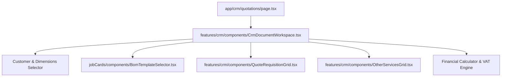

# Technical Migration Plan: Rich CRM Quotation Workspace

This document outlines the step-by-step implementation plan to migrate and rebuild the rich **CRM Quotation / Invoice Builder Workspace** from the Vue codebase into the **Next.js** (`project-management-next`) application.

Currently, the Next.js Quotation creator is a simplified single-modal modal with manual text inputs. This plan guides you on how to reconstruct the full, highly interactive spreadsheet-style document builder.

---

## 1. High-Level Target Architecture

The target workspace should replace the basic modal in `src/app/crm/quotations/page.tsx` with a dual-view interface:
1. **List View**: The datatable of all current quotes (existing).
2. **Workspace View**: A rich, fullscreen-width editor that replaces the page content when creating or editing a quote.

### Component Dependency Diagram


---

## 2. Directory & File Structure

Create a new `crm` feature area in the Next.js source tree to house the migrated files:

```bash
src/
└── features/
    └── crm/
        ├── components/
        │   ├── CrmDocumentWorkspace.tsx   # Core editor workspace wrapper
        │   ├── QuoteRequisitionGrid.tsx   # Requisition item grid with pricing/markup
        │   └── OtherServicesGrid.tsx      # Manual services (Labor/Transport) grid
        └── utils/
            └── generateCrmPdf.ts          # PDF builder using pdfmake (adapted)
```

---

## 3. Firestore Document Schema

The saved quotations in the `crmQuotes` collection should match this structural schema:

```typescript
export interface FirestoreQuote {
  id?: string;
  quoteNumber: string;         // e.g. QT-1837182938
  customerId: string;          // Ref to customers collection
  customerName: string;
  customerEmail?: string;
  dimensionsOfStructure?: string; // e.g. "120x15x4.5m"
  status: 'DRAFT' | 'SENT' | 'ACCEPTED' | 'REJECTED';
  validUntil: string;          // ISO date or YYYY-MM-DD
  notes?: string;

  // Segmented materials (requisition sections)
  requisitionSections: Array<{
    id: string;
    jobCategoryId: string;     // Ref to jobCategories
    description: string;
    items: Array<{
      id: string;
      inventoryItemId: string; // Ref to inventoryItems
      itemName: string;
      description?: string;
      qtyRequired: number;
      irdSellingPrice: number; // Base catalog selling price
      markupPercent: number;   // TWID custom markup
    }>;
  }>;

  // Flattened items array for PDF compatibility
  items: Array<{
    inventoryItemId: string;
    description: string;       // Item Name
    qty: number;
    price: number;             // Base irdSellingPrice
    markupPercent: number;
    total: number;             // (qty * price) * (1 + markupPercent/100)
  }>;

  // Manual non-inventory services
  otherServices: Array<{
    description: string;
    qty: number;
    price: number;             // Unit price
    total: number;             // qty * price
  }>;

  // Calculation summaries
  summary: {
    totalIrdCost: number;      // Sum of base (qty * sellingPrice) for inventory
    totalMarkup: number;       // Sum of markups for inventory
    totalOtherServices: number;// Sum of otherServices totals
    subtotal: number;          // totalIrdCost + totalMarkup + totalOtherServices
    vatRate: number;           // e.g., 15
    vatAmount: number;         // subtotal * (vatRate/100)
  };
  grandTotal: number;          // subtotal + vatAmount
  createdAt: any;
  updatedAt: any;
}
```

---

## 4. Rebuilding the Component Layer

### Step 4.1: `OtherServicesGrid.tsx`
Create `src/features/crm/components/OtherServicesGrid.tsx`. Reconstruct the Vue keyboard-navigable spreadsheet grid in React:
- **Columns**: `description` (width: 50%), `qty` (10%), `unitPrice` (20%), `total` (20%, Readonly).
- **Actions**: Add Row (dashed button), Delete Row.
- **Formulas**: `total = qty * unitPrice`.

### Step 4.2: `QuoteRequisitionGrid.tsx`
Create `src/features/crm/components/QuoteRequisitionGrid.tsx` (adapted from jobCards version but containing custom markups):
- Renders segmented categories (sections) mapped to `jobCategories`.
- Item columns must include:
  1. **Item Select**: Searchable dropdown.
  2. **Description**: Text field.
  3. **Qty**: Number field.
  4. **Base Price**: Readonly unit price pulled from catalog (`sellingPrice`).
  5. **TWID Markup %**: Percent input.
  6. **Total**: Readonly calculate row value.
- **Formulas**:
  $$\text{baseIRD} = \text{qty} \times \text{price}$$
  $$\text{markupValue} = \text{baseIRD} \times \left(\frac{\text{markupPercent}}{100}\right)$$
  $$\text{totalPrice} = \text{baseIRD} + \text{markupValue}$$

### Step 4.3: `CrmDocumentWorkspace.tsx`
Create `src/features/crm/components/CrmDocumentWorkspace.tsx` to orchestrate everything:
- **State Management**:
  - `draftCustomer` string (selected customer doc ID).
  - `dimensionsOfStructure` string.
  - `draftSections` list of sections.
  - `draftServices` list of custom services.
- **BOM Template Selector integration**:
  - Re-use the existing `<BomTemplateSelector />` component from `src/features/jobCards/components/BomTemplateSelector.tsx`.
  - Pass the current `dimensionsOfStructure` and `inventoryItems` down.
  - Map applied BOM items to `draftSections`.
- **Financial Calculation Engine**:
  - Pull `vatEnabled` and `vatRate` from the Next.js `useAdminStore` appSettings.
  - Dynamically recalculate all totals inside a React `useMemo` block whenever `draftSections` or `draftServices` change:
    ```typescript
    const totals = useMemo(() => {
      // Sum requisition sections
      let totalIrdCost = 0;
      let totalMarkup = 0;
      draftSections.forEach(sec => {
        sec.items.forEach(item => {
          const base = (item.qtyRequired || 0) * (item.irdSellingPrice || 0);
          totalIrdCost += base;
          totalMarkup += base * ((item.markupPercent || 0) / 100);
        });
      });
      // Sum services
      const serviceTotal = draftServices.reduce((sum, s) => sum + (s.total || 0), 0);
      const subtotal = totalIrdCost + totalMarkup + serviceTotal;
      const vatAmount = vatEnabled ? (subtotal * vatRate / 100) : 0;
      const grandTotal = subtotal + vatAmount;

      return { totalIrdCost, totalMarkup, serviceTotal, subtotal, vatAmount, grandTotal };
    }, [draftSections, draftServices, vatEnabled, vatRate]);
    ```

---

## 5. Integrating with Next.js Pages

Update `src/app/crm/quotations/page.tsx`:

1. **Workspace Toggle**:
   - Add state `isCreateMode` (boolean).
   - If `isCreateMode` is true, render the `<CrmDocumentWorkspace />` component in full page width.
   - If false, render the standard quotations list table.

2. **Fetching Data**:
   Ensure `fetchQuotes()`, `fetchCustomers()`, and `adminStore.fetchSettings()` are initialized on page mount so the workspace has autocomplete options.

3. **Handling Save**:
   When the workspace emits `@save`, enrich the payload with:
   - `status: 'DRAFT'` (if new)
   - Unique reference `quoteNumber`: `QT-${Date.now().toString().slice(-6)}`
   - Push to Firestore: `crmQuotes` collection.
   - Call `syncLeadStage` from CRM store to set the customer's CRM stage to **"Negotiation"**.
