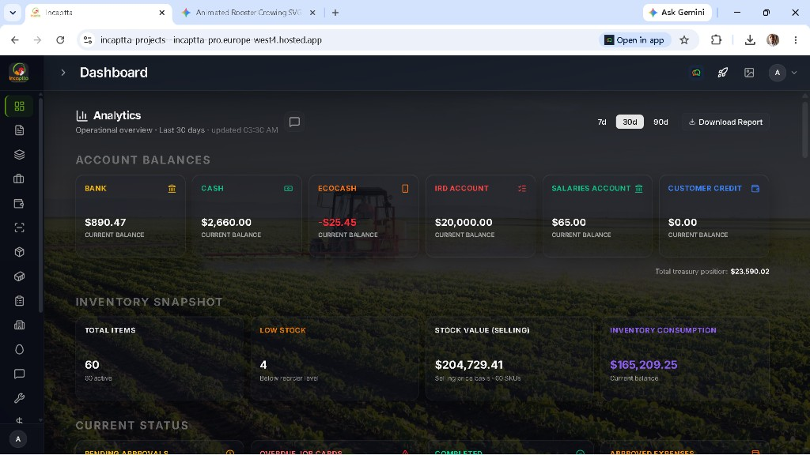
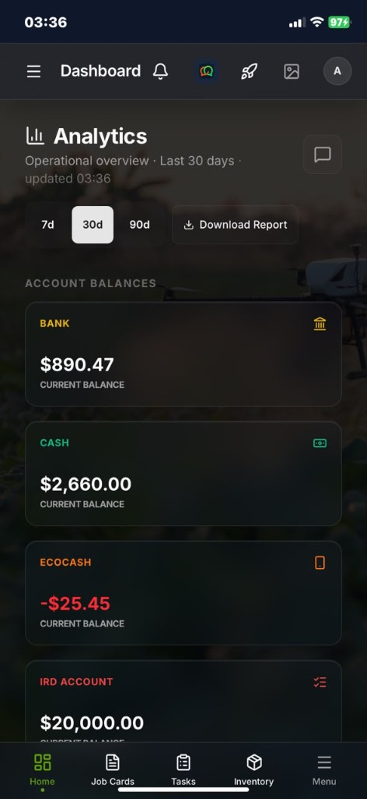
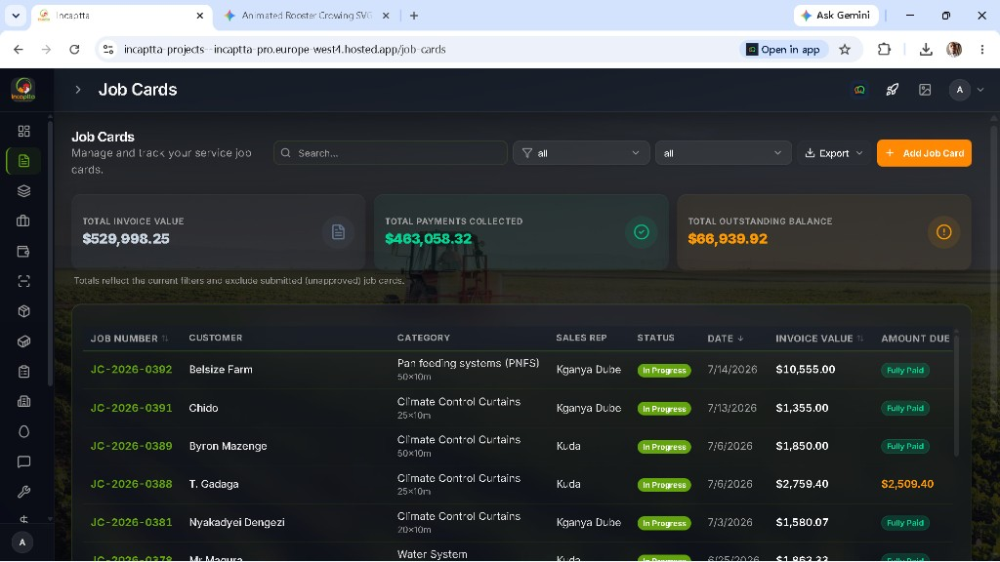
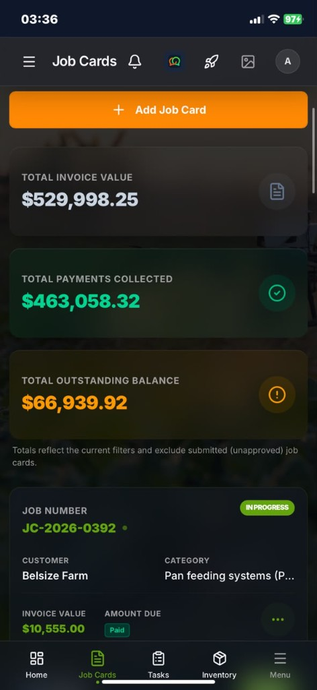
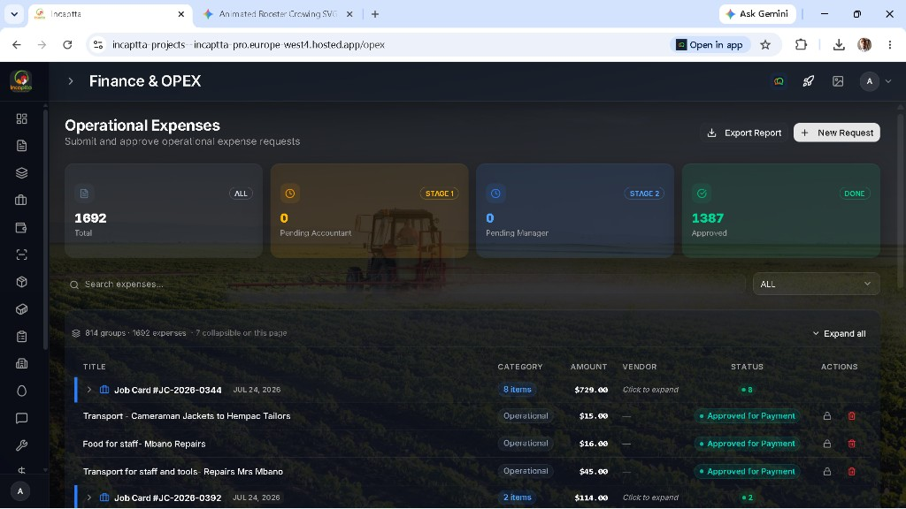
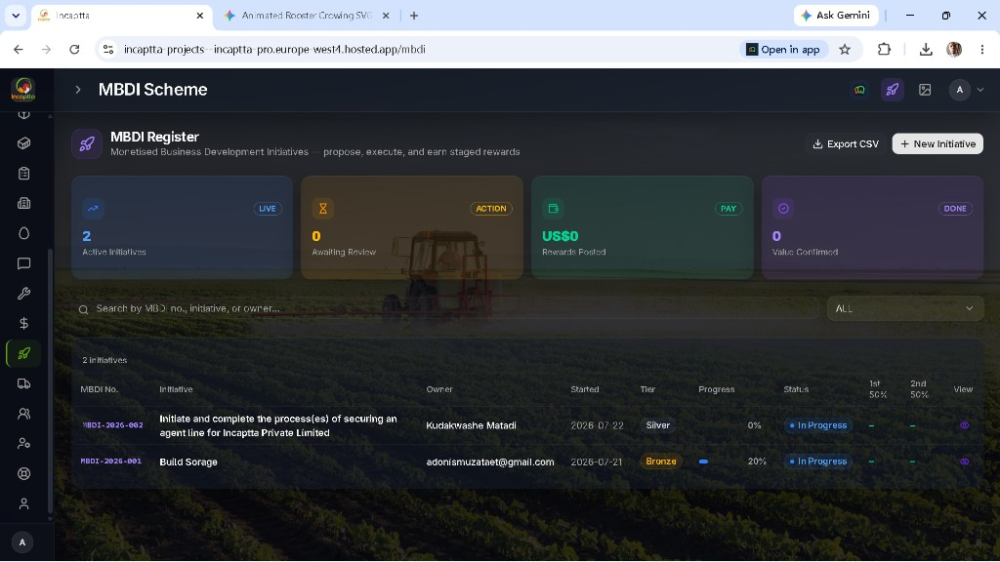
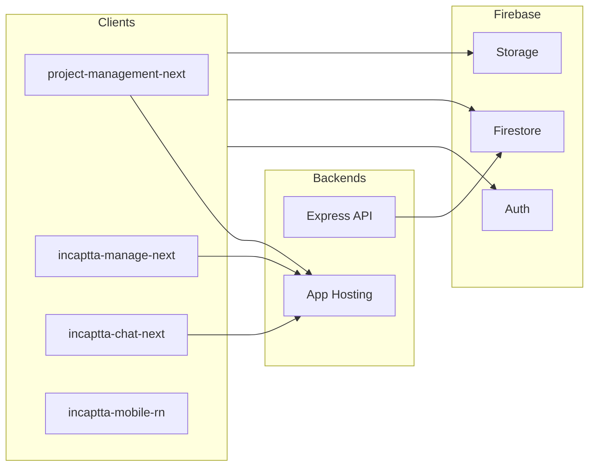

# Incaptta

**Operations platform for agri-structures and field service** — job cards, finance, inventory, CRM, and team collaboration in one Firebase-backed system.

Incaptta (IncapttaPro) helps Incaptta Private Limited run poultry and agri-structure projects end to end: from quotations and job execution to operational expenses, treasury balances, inventory, and incentive schemes (MBDI).

---

## Product gallery

### Dashboard

Treasury balances, inventory snapshot, and operational analytics (desktop and mobile).





### Job Cards

Track invoice value, payments collected, and outstanding balances across service jobs.





### Finance & OPEX

Submit and approve operational expenses through accountant and manager stages.



### MBDI Scheme

Monetised Business Development Initiatives — propose, execute, and earn staged rewards.



---

## What is Incaptta?

Incaptta is a multi-app ERP-style platform centered on **service job cards** for agricultural infrastructure (feeding systems, climate control, poultry housing, and related work). Core capabilities include:

- **Dashboard** — account balances (Bank, Cash, EcoCash, IRD, salaries, customer credit), inventory KPIs, pending approvals, and period analytics with report export
- **Job Cards** — lifecycle tracking for field/service jobs with invoice value, collections, outstanding balances, categories, and sales reps
- **CRM** — customers, leads, quotations, and invoices
- **Finance & OPEX** — multi-stage expense approvals, fund transfers, ledger, auto-approvals, and pay review
- **Inventory** — stock, low-stock alerts, valuations, consumption, and requisitions tied to jobs
- **MBDI** — initiative register with tiers, progress, and staged reward tracking
- **Chat** — team messaging with attachments and job-card context
- **Agric Structures / Poultry** — calculators and tools (e.g. fowlrun) that feed into job cards
- **Procurement & Accounting** — PR → PO → GRN flow, tax/VAT, and sales reports
- **HR, Tasks, Equipment Hire, Container Access, Commissions, Admin**

Role-based access (Firebase Auth + Firestore user roles) gates modules for Admin, Manager, Accountant, Sales, Technical, Storekeeper, Director, and related roles.

---

## Monorepo map

This repository is a **multi-package** codebase (not a single npm workspace). Active product work is primarily **Next.js**; Vue apps are largely legacy reference.

| Path | Role |
|------|------|
| [`project-management-next/`](project-management-next/) | **Primary ERP** — Next.js 16 App Router (active) |
| [`incaptta-manage-next/`](incaptta-manage-next/) | Manager dashboard — Next.js (active) |
| [`incaptta-chat-next/`](incaptta-chat-next/) | Standalone chat PWA — Next.js (active) |
| [`incaptta-mobile-rn/`](incaptta-mobile-rn/) | Expo / React Native field app |
| [`incaptta-web/`](incaptta-web/) | Marketing site (Vue 3 + Vite PWA) |
| [`project-management/`](project-management/) | Legacy Vue 3 ERP (read-only reference) |
| [`incaptta-manage/`](incaptta-manage/) | Legacy Vue 3 manager app (reference) |
| [`incaptta-mobile/`](incaptta-mobile/) | Older Ionic Vue + Capacitor mobile |
| Root [`src/`](src/) + [`deploy/`](deploy/) | Express / Cloud Functions API |
| [`shared/`](shared/) | Shared financial engine (IRD/TWID job-card math) |
| [`scripts/`](scripts/) | Ops and migration scripts |

---

## Architecture



- **Clients** talk to **Firebase Auth**, **Firestore**, and **Storage** directly for most UI data.
- **Express API** (root `src/`, deployed via Functions / Hosting rewrite) handles inventory, job requisitions, billing helpers, stock ledger, OPEX-related server logic, and integrations.
- **Firebase App Hosting** serves the Next.js apps (`apphosting.yaml` in each Next package).
- Legacy Vue builds still map to classic Firebase Hosting targets where configured in `firebase.json`.

Firebase project id: **`incaptta-pro`**.

---

## Core modules (ERP)

Implemented mainly in [`project-management-next`](project-management-next/) (sidebar / App Router):

| Module | Description |
|--------|-------------|
| **Dashboard** | Analytics windows (7d / 30d / 90d), treasury cards, inventory snapshot, status widgets |
| **Job Cards** | Create/manage jobs, financial totals, PDF/export, status workflow |
| **BOM Templates** | Bill-of-materials templates for structured jobs |
| **CRM** | Customers, quotations, invoices, leads |
| **Finance** | OPEX, transfers, ledger, auto-approvals, payment submissions |
| **Inventory** | Items, stock levels, valuations, consumption |
| **Container Access** | Site/container access workflows |
| **Tasks** | Operational task tracking |
| **Agric Structures / Poultry** | Domain calculators and project tools |
| **Chat** | In-app messaging (also standalone chat app) |
| **MBDI** | Business development initiative register |
| **Equipment Hire** | Hire/standby day management |
| **HR** | Roster, payroll-related surfaces, performance |
| **Procurement** | Purchase requests, POs, GRNs, supplier invoices |
| **Accounting** | Tax, VAT, sales reports |
| **Admin / Support / Tools** | Settings, branding, support, utilities |

Manager-focused views also live in [`incaptta-manage-next`](incaptta-manage-next/).

---

## Tech stack

| Layer | Technologies |
|-------|----------------|
| **Web ERP / Manage / Chat** | Next.js 16, React 19, TypeScript, Tailwind CSS v4, Zustand, Base UI / shadcn-style components |
| **Mobile** | Expo 54 / React Native (primary); Ionic Vue + Capacitor (legacy) |
| **Marketing** | Vue 3, Vite, PWA |
| **Legacy ERP** | Vue 3, Vite, Pinia |
| **Backend** | Express 5, Zod, Jest, Firebase Admin |
| **Data & auth** | Firebase Auth, Firestore, Storage, Cloud Messaging |
| **Docs & reports** | jsPDF, ExcelJS, Unovis charts |
| **Integrations** | Google Gemini / DeepSeek (analytics), Resend (email), EcoCash webhooks |

---

## Getting started (developers)

### Prerequisites

- **Node.js 18+**
- Access to the **Firebase** project (`incaptta-pro`) and appropriate env / App Hosting secrets
- For API work: Google application credentials or an environment with default GCP credentials

### Primary ERP (recommended start)

```bash
cd project-management-next
npm install
npm run dev
```

Configure Firebase client env vars for the Next app as used in that package (see local `.env` / App Hosting config). Do not commit secrets.

### Other apps

```bash
# Manager dashboard
cd incaptta-manage-next && npm install && npm run dev

# Chat
cd incaptta-chat-next && npm install && npm run dev

# Expo mobile
cd incaptta-mobile-rn && npm install && npx expo start
```

### Express API (repository root)

```bash
npm install
npm run dev    # development server
npm test       # Jest
npm run build
```

Full endpoint list, RBAC notes, and emergency `SUPER_ADMIN` recovery:

→ **[docs/backend-api.md](docs/backend-api.md)**

---

## Deployment

| Surface | How |
|---------|-----|
| **Next.js ERP (Cloudflare)** | Cloudflare Workers / Pages via `@opennextjs/cloudflare` (`project-management-next/wrangler.jsonc`) |
| **Marketing (Cloudflare)** | Cloudflare Pages static hosting (`incaptta-web/wrangler.toml`, build output `dist/`) |
| **Database** | MongoDB Atlas (`MONGODB_URI`) + Firestore transition bridge |
| **Next.js apps (Firebase)** | Firebase **App Hosting** — see `apphosting.yaml` in `project-management-next`, `incaptta-manage-next`, `incaptta-chat-next`, `incaptta-web` |
| **Legacy Vue / static** | Firebase **Hosting** targets in `firebase.json` (e.g. `main`, `manager`, `mobile`, `web`) |
| **API** | Cloud Functions codebase under `deploy/` (Hosting can rewrite `/api/**`) |
| **Rules** | Root `firestore.rules`, `firestore.indexes.json`, `storage.rules` |

---

## Documentation index

| Doc | Topic |
|-----|--------|
| [docs/cloudflare-mongodb-deployment-guide.md](docs/cloudflare-mongodb-deployment-guide.md) | **Cloudflare deployment & MongoDB Atlas setup guide** |
| [docs/backend-api.md](docs/backend-api.md) | Express API setup, endpoints, testing, break-glass admin |
| [architecture_specification.md](architecture_specification.md) | Broader architecture specification |
| [REACT_NATIVE_ARCHITECTURE_SPEC.md](REACT_NATIVE_ARCHITECTURE_SPEC.md) | Mobile architecture |
| [incaptta-mobile-rn/README.md](incaptta-mobile-rn/README.md) | Expo app developer notes |
| [project-management-next/docs/procurement-inventory-integration.md](project-management-next/docs/procurement-inventory-integration.md) | Procurement ↔ inventory |
| [INCAPTTAPRO_PROCUREMENT_BLUEPRINT.md](INCAPTTAPRO_PROCUREMENT_BLUEPRINT.md) | Procurement blueprint |
| [CLINE_MIGRATION_RULES.md](CLINE_MIGRATION_RULES.md) | Vue → Next migration rules (legacy packages are reference) |
| [PENDING_MIGRATION_MODULES.md](PENDING_MIGRATION_MODULES.md) | Migration status |

Agent / Next.js notes: each Next app may include `AGENTS.md` — this stack uses a current Next.js release with APIs that can differ from older training data; prefer the local `node_modules/next` docs when changing those apps.

---

## Contributing notes

- Prefer changes in **Next.js** packages (`*-next`) over legacy Vue unless you are fixing a hosting-only legacy path.
- Keep Firebase security rules and role checks in sync with new UI surfaces.
- Do not commit `.env`, service account keys, or secret material.
- For large domain work, check existing blueprints under the repo root before inventing parallel data models.

---

## License

Private / proprietary — Incaptta Private Limited. All rights reserved unless otherwise stated by the owners.
