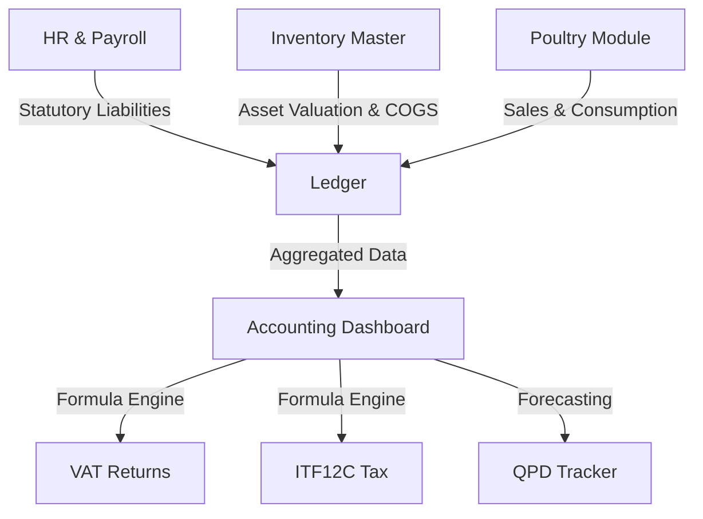

# IncapttaPro Accounting Module Architecture

This document outlines the technical and functional architecture for the IncapttaPro Accounting Module, derived from the organization's financial standards and automated Excel templates.

## 1. Executive Summary
The Accounting Module acts as the central financial brain of IncapttaPro, aggregating data from the **HR (Payroll)**, **Inventory Master**, and **Poultry** modules to provide real-time compliance reporting (VAT, ITF12C), profit analysis, and balance sheet valuation.

---

## 2. Core Components

### A. The Financial Ledger (Engine)
*   **Collection**: `accountingTransactions`
*   **Logic**: A double-entry inspired ledger that records every movement of value.
*   **Key Fields**: `debitAccount`, `creditAccount`, `amount`, `currency` (USD/ZWG), `exchangeRate`, `referenceId` (Job Card, Payroll ID, or Invoice), `taxCategory`.

### B. Tax Compliance Engine (ITF12C & VAT)
*   **VAT Calculator**: Pulls Output VAT from Sales (Poultry, Job Cards) and Input VAT from Purchases (Procurement).
*   **ITF12C Computation**: Automated logic for Net Profit reconciliation, Add Backs (Depreciation, Non-deductible expenses), and Capital Allowances.
*   **QPD Tracker**: Forecasts and tracks Quarterly Payment Dates based on projected and actual annual income.

---

## 3. Module Integrations

### HR & Payroll Integration
*   **Automated PAYE/AIDS Levy**: Using 2025 progressive tax tables for Zimbabwe.
*   **Statutory Liability Tracking**: When payroll is processed, the system credits **Liability Accounts** (ZIMRA Payable, NSSA Payable) instead of just marking an expense.
*   **Employment Cost Analysis**: Direct feed into the ITF12C "Operating Expenses" section.

### Inventory Master & COGS Integration
*   **Asset Valuation**: Live tracking of "Inventory Assets" based on `SUM(onHand * totalCost)`.
*   **COGS Automation**: Automatic recognition of **Cost of Goods Sold** upon completion of Job Cards or Poultry Sales.
*   **Consumption Logic**: Feed and Medication usage in the Poultry module is automatically reclassified from "Inventory Asset" to "Biological Operating Cost."

### Poultry Module Integration
*   **Biological Asset Tracking**: Flocks are treated as assets that grow in value over time.
*   **Revenue Recognition**: Poultry sales are recorded with multi-currency support, feeding directly into VAT and Sales reports.

---

## 4. Technical Architecture

### Data Flow Diagram (High Level)

### Key Services & Utilities
1.  **`payrollCalculations.ts`**: Handles progressive tax and statutory deductions.
2.  **`taxEngine.ts`**: Houses the logic for ITF12C and VAT reverse calculations.
3.  **`inventoryValuation.ts`**: Computes WAC (Weighted Average Cost) and total asset value.
4.  **`currencyService.ts`**: Manages ZWG/USD conversions and exchange rate history.

---

## 5. Security & Access Control
*   **Roles**: Restricted to `ACCOUNTANT`, `MANAGER`, and `SUPER_ADMIN`.
*   **Immutability**: Once a tax period is "Closed," ledger entries for that period are locked to prevent retroactive changes.
*   **Audit Logging**: Every transaction is timestamped and linked to the `uid` of the posting officer.

---

## 6. Implementation Roadmap
1.  **Phase 1**: Statutory Ledger Integration (PAYE, NSSA tracking).
2.  **Phase 2**: Inventory Asset & COGS automation.
3.  **Phase 3**: Automated VAT & ITF12C Dashboards.
4.  **Phase 4**: Multi-currency reconciliation & Financial Reports (P&L, Balance Sheet).
